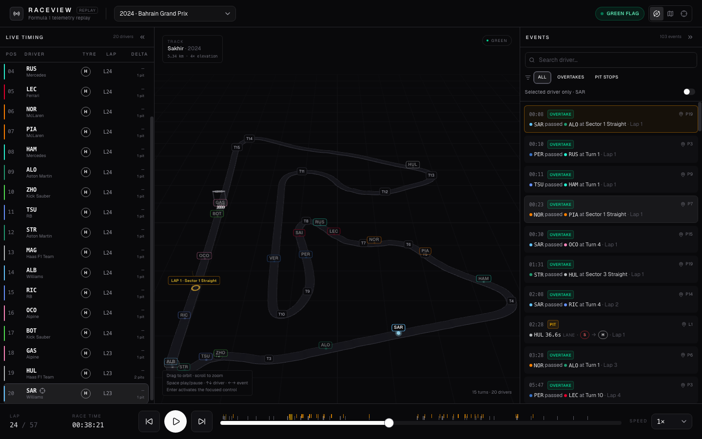
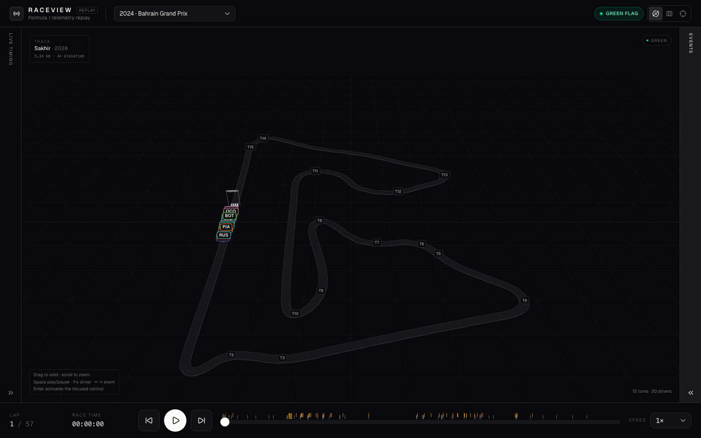

# RaceView

A zero-backend Formula 1 race replay and telemetry visualiser. Pre-processed race data is shipped as static JSON, so the whole app runs on GitHub Pages.





## What it does

- 3D circuit ribbon with real elevation (4× exaggeration), start/finish gantry, turn markers, and every car smoothly interpolated between one-second frames.
- Three-column desktop layout: live timing on the left, 3D track in the centre, events on the right; both sidebars stay visible and each collapses to a narrow rail.
- Free-orbit, top-down, and selected-driver follow cameras.
- Follow mode shows a compact car-telemetry panel with speed, gear, throttle, brake, DRS, lap, tyre, and pit count for the followed car.
- Live classification tower with position changes, team colours, tyre compound, pit count, and lap.
- Overtake and pit-stop feed with driver search, filters, selected-driver filtering, and click-to-seek to three seconds before the event.
- Larger playback bar with a 48 px play target, 44 px step targets, and a thicker timeline with a 20 px thumb.
- Track status badge and timeline bands for green, yellow, safety car, VSC, and red flag intervals.
- Playback speed from 1× to 20×, −5 s / +5 s stepping, and a full-width scrubber with event ticks.
- Full keyboard control: Space play/pause, arrow-key driver and event navigation, focus-visible rings, a skip link, and live status announcements.
- The complete 2025 season plus Bahrain, Monaco, and Spa from 2024, in one season-grouped selector.

## Stack

React 19 · TypeScript · Vite · Tailwind CSS v4 · shadcn/ui (Base UI) · Three.js · React Three Fiber · drei

## Run locally

```bash
npm install
npm run dev
```

Race JSON is committed in `public/data/`, so no Python step is needed to run the app.

## Keyboard

- **Space** — play or pause. This is global, except while a select, slider, switch, tab, link, or text field is focused, where the control keeps its native Space behaviour.
- **↑ / ↓** — previous or next driver in the running order. Inside the timing tower the focus moves with the selection.
- **← / →** — previous or next overtake or pit event. The replay seeks to three seconds before it and focuses the event card in the right sidebar.
- **Enter** — activate the focused button, tab, or link. Use this for buttons because Space is reserved for playback.
- **Escape** — clear the selected driver and pinned event.
- **Sidebar collapse** — Tab to the collapse button in a sidebar header and press Enter; Tab to the rail button and press Enter to reopen it.
- **Tab** — move through the skip link, race selector, camera presets, 3D viewport, timing tower, event feed, and playback controls.

The 3D viewport is focusable and labelled, the timing tower and event feed use focus-visible rings, and a polite live region announces the track status, selected driver, and pinned event.

## Data pipeline

The catalog currently covers **2023 and newer**, because telemetry comes from [OpenF1](https://openf1.org), which has no authentication and the same 3.7 Hz position feed. FastF1 supplies circuit corners through its anonymous MultiViewer integration. FastF1 telemetry itself is not used: current FastF1 versions require an F1TV login for the timing endpoints, and the project stays credential-free.

```bash
python3 -m venv scripts/.venv
scripts/.venv/bin/pip install -r scripts/requirements.txt
scripts/.venv/bin/python scripts/export_race_data.py --year 2024 --races "Bahrain,Monaco,Spa"
scripts/.venv/bin/python scripts/export_race_data.py --year 2025 --races all
```

Output goes to `public/data/`:

- `races.json` — the selector catalog, merged with existing entries so adding one race does not remove the others.
- `<race>-<year>.json` — metadata, track geometry and corners, one-second driver frames, pits, overtakes, and track-status intervals.

Caches live in `.cache/openf1/` and `.cache/fastf1/` and are ignored by git. Adding another race is the same command with another name, or `--races all` to add every race session in a season; commit the regenerated JSON.

To add races in CI, run **Actions → Refresh race data** with the year and either a comma-separated list or `all`. The workflow caches the HTTP responses, exports the JSON, commits it to `main`, and lets the normal deployment run.

### Payload shape

- Coordinates are decimetres; `z` is elevation. The frontend scales the track to a 100-unit scene and applies 4× vertical exaggeration.
- Frames are one-second keyframes from the winner's start to the winner's chequered flag. The client interpolates positions, so playback stays smooth without shipping 3.7 Hz samples.
- Car telemetry uses the same one-second frames: speed in km/h, gear, throttle and brake from 0 to 100, and DRS. Missing, sentinel, and corrupt samples are `null`; a driver with no usable running telemetry omits the arrays entirely.
- Tyres use integer codes: `1` soft, `2` medium, `3` hard, `4` intermediate, `5` wet.
- Each race is roughly 3.2–4.5 MB raw (about 1 MB gzipped) and under the 6 MB validation limit.

## Verify

```bash
npm run build
npm run validate:data
npx playwright install chromium   # once
npm run test:e2e
```

`test:e2e` builds the app, starts `vite preview`, checks playback, keyboard shortcuts, list navigation, driver search, sidebar collapse, larger control targets, camera switching, follow telemetry, event seeking, race switching, responsive layout, and fails on console or page errors.

## Deploy to GitHub Pages

1. Push the repository to GitHub with `main` as the default branch.
2. In **Settings → Pages**, set the source to **GitHub Actions**.
3. Push to `main`, or run **Actions → Deploy to GitHub Pages**.

`vite.config.ts` derives the base path from `GITHUB_REPOSITORY`, so the project site works under `https://<user>.github.io/<repo>/`. The deploy workflow only runs Node: it validates the committed JSON, builds, uploads `dist/`, and deploys. Python is isolated in the manual refresh workflow.

## Architecture

- **Playback store**: a single requestAnimationFrame clock publishes a React snapshot at 20 Hz for the UI; the 3D scene reads the mutable clock directly and interpolates each driver's one-second keyframes, so the Canvas does not re-render at 60 Hz.
- **Position and events**: the exporter uses the official position feed, pairs one-place gains with the displaced driver, and filters pit windows, non-green status, lapped traffic, and duplicates. Corners come from FastF1's circuit metadata.
- **Static data**: no API is called at runtime. The selected race JSON is lazy-loaded; with a full-season catalogue, other races are not prefetched.

Decisions are recorded in [docs/adr](docs/adr), and the domain vocabulary is in [GLOSSARY.md](GLOSSARY.md).

## Notes and limits

- **Overtakes are heuristic.** There is no official overtake feed. Position changes are paired with the displaced driver, then filtered for pit windows, non-green track status, lapped traffic, and duplicates. Expect occasional missed or extra events at race starts and restarts.
- **Pit duration is often lane time**, because OpenF1 frequently has no stationary `stop_duration`. The feed marks these as `lane`; stop times are used when available.
- **Monaco 2024 has no red interval in the replay.** The red flag happened during the aborted start, before the classified race restarted; OpenF1's lap timeline starts at the restart. The status parser supports red flags for races where they fall inside the replay window.
- **Restart position feeds can glitch.** OpenF1's Monaco restart leaves one driver's location stale for roughly the first 30 seconds; the timing tower and event locations are unaffected.
- **Post-race penalties are not applied.** The replay shows on-track order, so Spa 2024 ends with Russell crossing first even though he was later disqualified.
- **Sector labels are approximate.** "Sector N Straight" is derived from thirds of the lap when an overtake is not near a mapped corner.
- **Collapsing a sidebar resets its local state.** The panel is unmounted, so its search, filters, and scroll position are fresh when reopened.
- **Car telemetry has gaps.** OpenF1 sends sentinel values for retired cars and occasionally drops samples. The exporter stores nulls, and the follow panel shows "No telemetry" or "Out" rather than inventing data. A 5-second feed outage is held at its last sample.
- **Pre-start retirements.** A DNS or formation-lap retirement has no in-window location samples; the exporter holds the last known position and removes the car at the green flag.
- **2025 Miami's lap feed starts at lap 26.** OpenF1 omits laps 2–25 and some lap start times. The exporter recovers the race start from the winner's official duration and interpolates the lap counter across the gap; positions and telemetry are unaffected.
- **2025 Spain has 19 starters.** Lance Stroll withdrew after qualifying, so that race file has 19 drivers; the validator accepts 19 or 20.
- Only races where OpenF1 has telemetry (2023+) can be exported.

## Attribution

Telemetry: [OpenF1](https://openf1.org). Circuit metadata: [FastF1](https://docs.fastf1.dev) / [MultiViewer](https://multiviewer.app). This is an unofficial, non-commercial project and is not associated with Formula 1, the FIA, or any team. No official logos or broadcast material are included. Check the upstream data terms before redistributing derived data.
